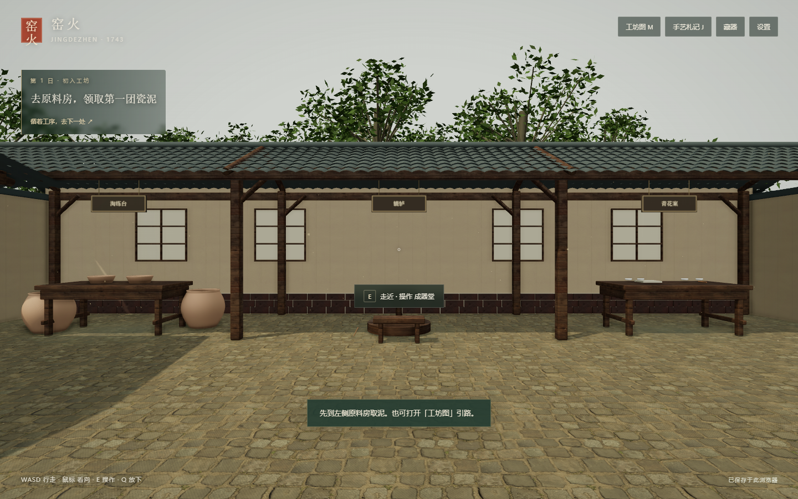
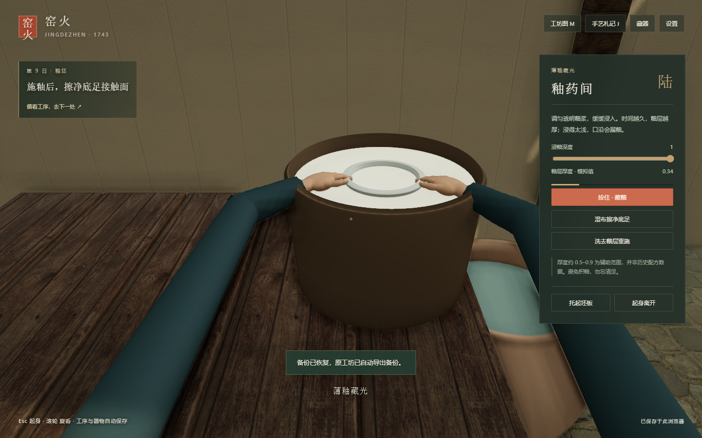
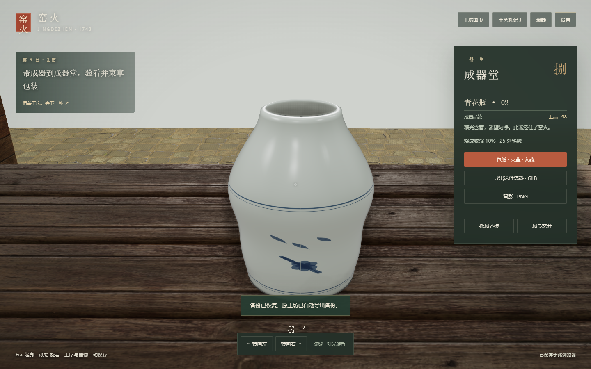

# Chrome 实机验证材料

- [验证结论、设备、方法和限制](../docs/VERIFICATION.md)
- [最终实机短录像](review/visual-replay-v04.webm)：有意使用已完成作品的存档重放，便于观察双手、几何、蘸釉、火光和包装。
- `playtest.json`：碗与瓶从原料到入藏的真实键鼠全流程记录。
- `release-check.json`：独立解压发布版的碰撞、拾放、恢复与离线结果。
- `performance.json`：1080p 固定路线的性能测量，未混入录像开销。
- `extracted-assets-check.json`：独立目录中的 Blender 源资产及 GLB 回读。
- `exports/`：完整游玩产生的实际 GLB、PNG、JSON 样品，可直接在游戏设置中导入 `workshop.json` 查看作品。

## 最终实机画面

## 前后对照

早期手部及木料：[v01](review/before-wheel-v01.png) → [v04](review/03-wet-clay-replay-v04.png)。

蘸釉出画：[v02](review/before-glaze-v02.png) → [v04](review/05-dip-lift-replay-v04.png)。

窑前构图：[v02](review/before-kiln-v02.png) → [v04](review/07-kiln-replay-v04.png)。

这些是不同版本和对应阶段的实机复核材料；镜头和作品可能不同，不作为固定机位的性能对比。未经项目所有者确认，不标记为已批准的写实视觉基准。
